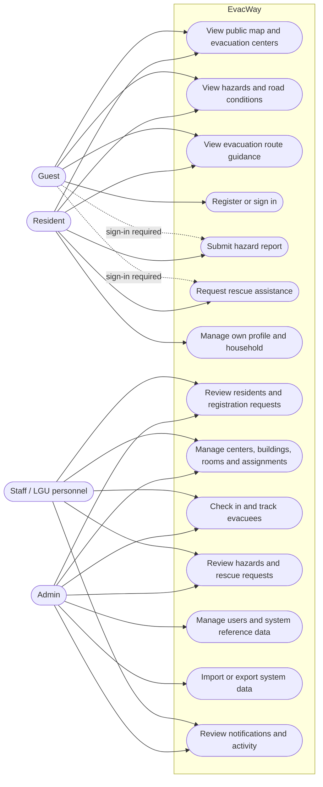
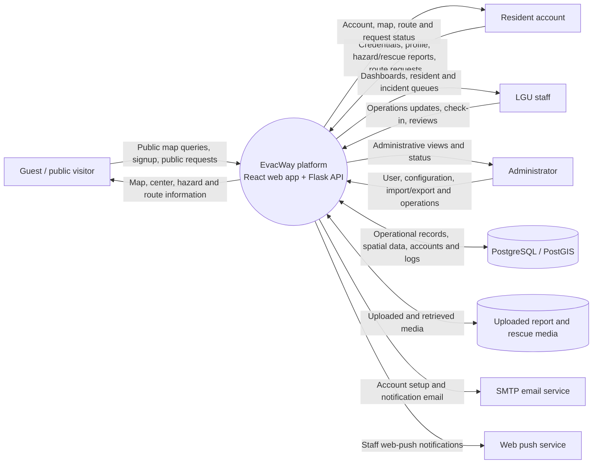
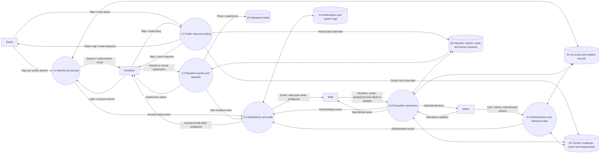
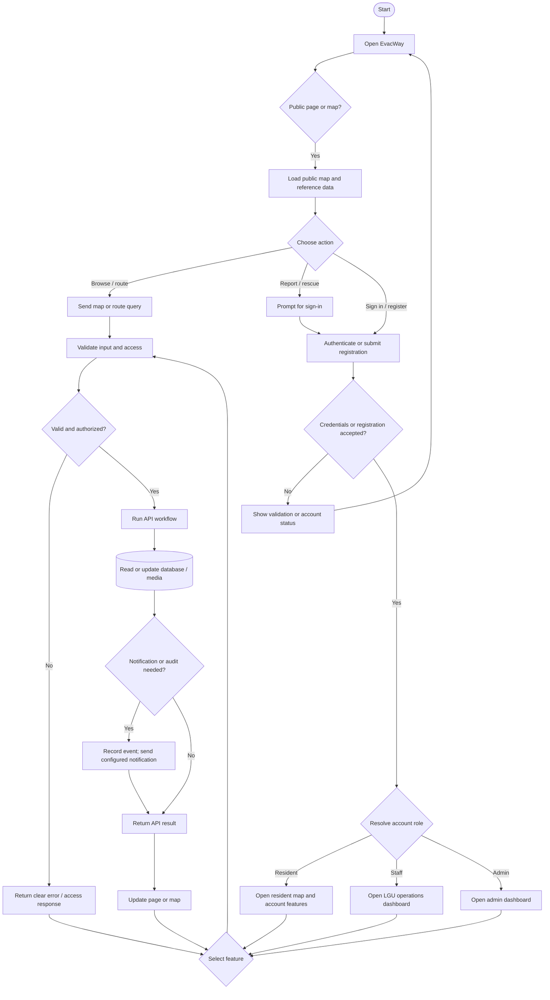

# EvacWay System Structure Guide

This guide summarizes EvacWay's user roles, major use cases, application context, data movement, system flow, and functional decomposition. It is based on the current React frontend, Flask API, and SQLAlchemy data model. It is intended as a system overview, not a substitute for endpoint-level authorization rules.

## 1. Scope and role names

| Guide role | Application role | Meaning |
| --- | --- | --- |
| Admin | `admin` | System administrator with user, reference-data, import/export, and emergency operations access. |
| Staff | `lgu_personnel` | LGU operations personnel who manage evacuation and response workflows. |
| Resident | `resident` | Authenticated resident account linked to a resident record. |
| Guest | Unauthenticated visitor | Anyone using the public landing page and public map without signing in. |

Guest access is limited to public information and account entry points. The public map is open, while hazard and rescue submission actions prompt for sign-in. Route and record access still depends on backend authorization; hiding a screen in the frontend is not the security boundary.

## 2. Use case guide

### Use case diagram

### Use case descriptions

| Use case | Primary actor | Main flow | Result |
| --- | --- | --- | --- |
| View public map | Guest, Resident | Open the public map; inspect centers, hazard zones/reports, roads and map details. | Current public map information is displayed. |
| Find a route | Guest, Resident | Choose or provide a location and destination; request route guidance. | A route is displayed when a valid route can be calculated. |
| Register / sign in | Guest, Resident | Submit registration or credentials; complete account setup when prompted. | A resident can access authenticated resident features after account approval/setup. |
| Report a hazard | Resident | Sign in, provide a location and report details, optionally attach photos, then submit. | A report is stored for staff review; review may update hazard/road state. |
| Request rescue | Resident | Sign in, provide request details and location, then submit. | Staff can see and update the rescue request. |
| Manage evacuation operations | Staff | Review resident registrations; maintain households and centers; assign/check in evacuees; respond to reports and requests. | Operational records and response status are updated. |
| Administer EvacWay | Admin | Perform staff operations plus manage users and reference data and run supported imports/exports. | System setup data and administrative records are maintained. |

Use case coverage follows current visible routes and API role decorators. A feature's exact scope can vary by endpoint; consult the route implementation when changing permissions.

## 3. Context diagram

SMTP and web-push are optional integration points configured by deployment settings. The diagram shows logical dependencies; it does not promise delivery when an integration is unconfigured or unavailable.

## 4. Data flow diagram (level 1)

The stores above are conceptual groups of tables and uploaded files, not literal database schemas. The current model includes users and resident accounts, residents and families, evacuation centers/buildings/rooms/assignments, hazard zones/reports/photos, roads, rescue requests, notifications, and system logs.

## 5. System flowchart

## 6. Functional decomposition diagram (FDD)

```mermaid
flowchart TD
    Root[EvacWay Emergency Evacuation and Response System]
    Root --> F1[1. Access and accounts]
    Root --> F2[2. Public information and mapping]
    Root --> F3[3. Resident services]
    Root --> F4[4. Evacuation operations]
    Root --> F5[5. Emergency response]
    Root --> F6[6. Administration]
    Root --> F7[7. Notifications and records]

    F1 --> F11[Authenticate users]
    F1 --> F12[Register resident]
    F1 --> F13[Set up / reset password]
    F1 --> F14[Authorize by role]

    F2 --> F21[Display evacuation centers]
    F2 --> F22[Display hazards and roads]
    F2 --> F23[Calculate evacuation route]
    F2 --> F24[Show map details]

    F3 --> F31[Manage resident profile]
    F3 --> F32[View household / center information]
    F3 --> F33[Submit hazard report]
    F3 --> F34[Request rescue assistance]

    F4 --> F41[Review registration requests]
    F4 --> F42[Manage households and residents]
    F4 --> F43[Manage centers, buildings and rooms]
    F4 --> F44[Assign evacuees]
    F4 --> F45[Check in / track evacuees]

    F5 --> F51[Review hazard reports]
    F5 --> F52[Validate hazards / road blockage]
    F5 --> F53[Manage rescue requests]
    F5 --> F54[Register non-registered evacuees]

    F6 --> F61[Manage staff accounts]
    F6 --> F62[Manage reference options]
    F6 --> F63[Import / export operational data]
    F6 --> F64[Configure evacuation center data]

    F7 --> F71[Create staff notifications]
    F7 --> F72[Send configured email / web push]
    F7 --> F73[Record system activity]
```

## 7. Main information groups

| Information group | Main entities | Used by |
| --- | --- | --- |
| Identity and residents | Users, resident accounts, residents, families, registration requests | Access, resident services, staff operations |
| Evacuation capacity | Centers, center/barangay links, buildings, rooms, assignments | Public map and staff operations |
| Situational awareness | Hazard zones, hazard reports/photos, road segments | Public map, resident reports, staff review and routing |
| Emergency response | Rescue requests, non-registered evacuees | Resident requests and staff response/check-in |
| System operations | Notifications, push subscriptions, system logs, reference options | Staff/admin workflows |

## 8. Implementation references

- Frontend route and role gates: `frontend/src/App.jsx` and `frontend/src/components/ProtectedRoute/ProtectedRoute.jsx`.
- API route authorization and workflows: `backend/routes/`.
- Persistent entities: `backend/models.py`.
- Runtime service wiring: `backend/app.py`, `docker-compose.yml`.

